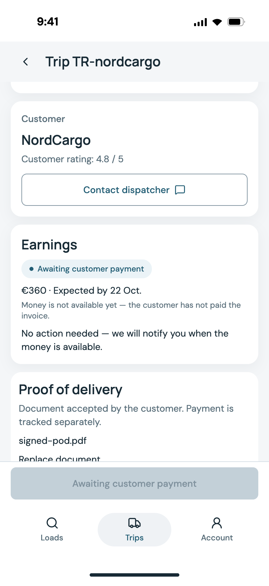
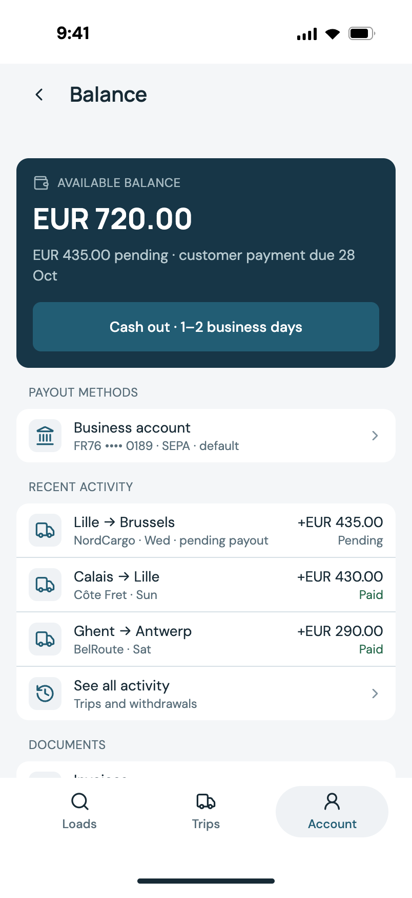
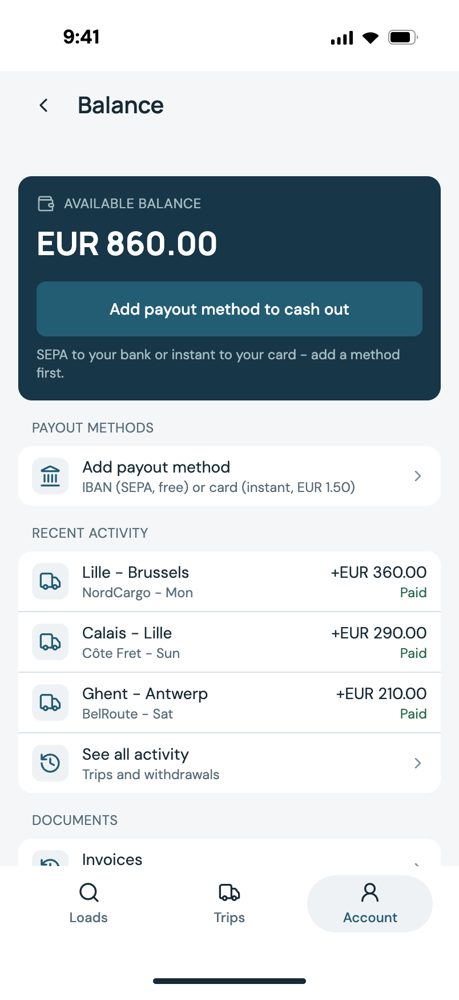
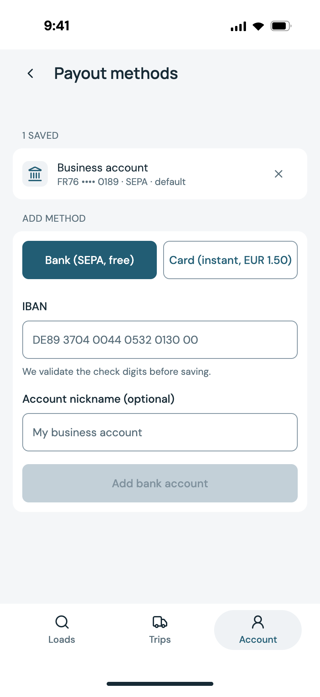
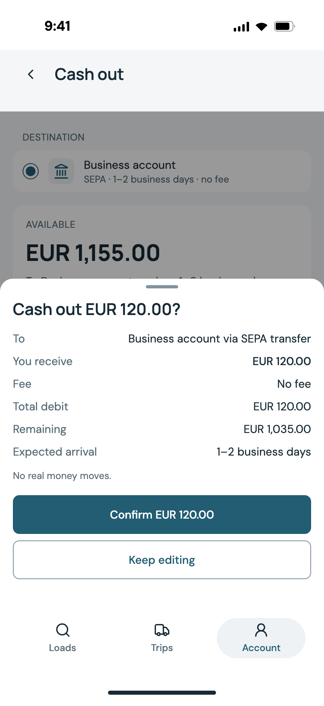
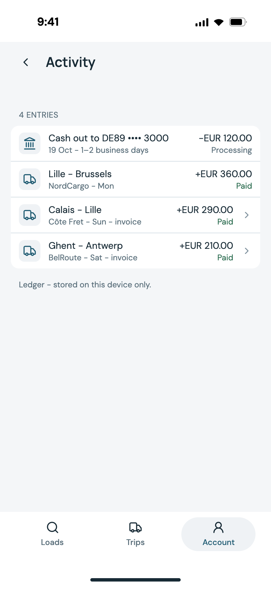
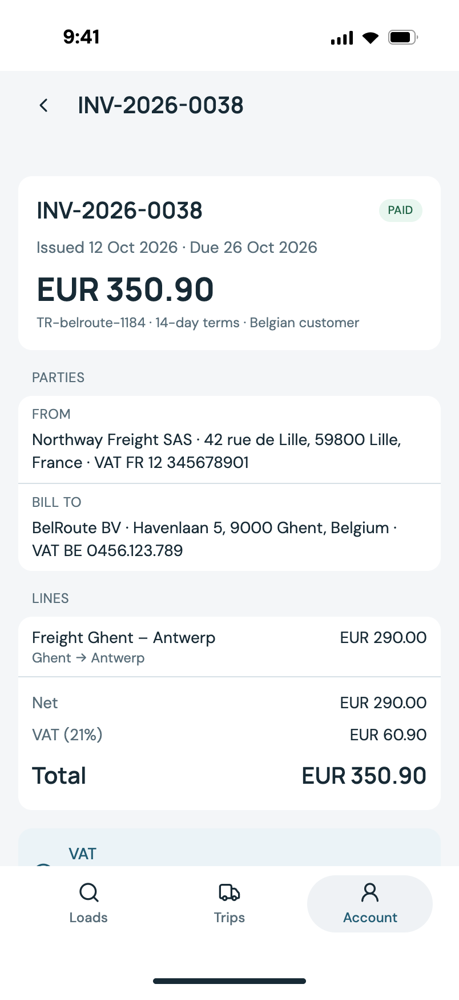
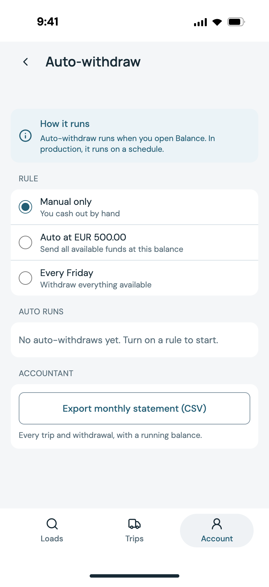

<div align="center">

# Pharos Driver

**A clickable prototype of a European freight-driver app, built around the money loop.**

`Book a load → deliver it → earnings land as pending → customer pays → balance releases → cash out by SEPA → resolve a failed payout`

React 19 · TypeScript · Vite · Tailwind v4 · Storybook 10 · Playwright · Vitest

[](https://github.com/designantonyui-source/pharos-driver-prototype/actions/workflows/pharos-validation.yml)
[](https://www.typescriptlang.org/)
[](https://react.dev/)
[](https://github.com/designantonyui-source/pharos-driver-prototype)

[Live prototype](https://pharos-driver-prototype.vercel.app) · [Case study](docs/CASE-STUDY.md) · [Demo script](docs/DEMO-SCRIPT.md) · [Payments vision](design/PAYMENTS-VISION.md)

</div>

---

## Why this project exists

Freight marketplaces are usually demoed as **maps and matching**. That part is table stakes, and it
screenshots badly. The part that actually decides whether a driver stays is money: *when does my
money arrive, can I get it out, and what happens when the bank says no?*

So I built this prototype **backwards from the money**. The loads feed, the application flow and the
trip screens exist to feed the ledger; the ledger is the product. Every screen in the payments area
is built around one question a real driver asks out loud:

> *"I earned €360 on Monday. Where is it, and when can I have it?"*

---

## The money loop

This is the flow to show. It runs end to end in the prototype, and every beat is covered by tests.

```
 ┌──────────────┐   ┌───────────┐   ┌──────────────┐   ┌───────────────┐
 │  Book a load │──▶│  Deliver  │──▶│  Pending     │──▶│ Customer pays │
 │  apply → send│   │  POD ok   │   │ EUR 360 held │   │  → Available  │
 └──────────────┘   └───────────┘   └──────────────┘   └───────┬───────┘
        │                                                        │
        │                                                        ▼
 ┌──────────────┐   ┌──────────────┐   ┌───────────────────────────────┐
 │  Cash out    │◀──│  Quote      │◀──│ Balance: available / pending  │
 │  SEPA + card │   │  fee + ETA  │   │  unified ledger + invoices    │
 └──────────────┘   └──────────────┘   └───────────────────────────────┘
        │
        ▼
 ┌──────────────────────────────────────────────┐
 │  Failure path: delayed → failed → refunded   │
 └──────────────────────────────────────────────┘
```

| Beat | What it proves |
|---|---|
| **Book** → **deliver** | Earnings are *earned* before they are *payable* — the trip creates a **pending** ledger line, never an available balance. |
| **Pending → available** | Money moves only when the customer pays, and the invoice flips to `paid` in the same transaction. |
| **Payout method** | IBAN validated with a real **mod-97** checksum; card details **Luhn**-checked and **tokenised** — a PAN never reaches storage. |
| **Quote before execute** | The confirm sheet shows fee, total debit, remaining balance and expected arrival *before* the provider is called. |
| **Two rails** | SEPA (free, 1–2 business days) and instant card (+€1.50, 30 min) — the card is a **speed option**, never the base. |
| **Failure path** | A rejected payout **returns the funds** to the balance; the fee is refunded only if policy says so. No silent money loss. |
| **Discipline** | Auto-withdraw schedules, an adjustment ledger (dispute / damage / bonus) and a monthly **CSV statement** for the accountant. |

### Screens

| | | |
|---|---|---|
|  |  |  |
| **Trip** — "€360, awaiting customer payment" | **Balance · pending** — earned ≠ available | **Balance · available** — released on payment |
|  |  |  |
| **Payout method** — SEPA IBAN, mod-97 validated | **Cash out** — fee, total debit, ETA, before the call | **Ledger** — one list for every money movement |
|  |  |  |
| **Invoice** — seller/buyer VAT, reverse charge | **Failure path** — delayed → failed → refunded | **Discipline** — auto-withdraw + statement |

*All screenshots are generated by `pnpm capture:case-study` — see [Demo script](docs/DEMO-SCRIPT.md).*

---

## The fintech part, concretely

This is the part I want to be judged on. Every claim below is implemented, not mocked in prose.

### 1. Two balances, not one

Freight runs on **net terms** — the driver earns on delivery, the platform pays on the customer's
terms (net 7/14). A single "balance" number would be a lie. The ledger distinguishes:

- **Available** — settled, withdrawable now
- **Pending** — earned, not yet payable, with the reason shown in the UI

`getBalance()` derives both from one ledger rather than storing two counters, so the two can never
drift apart. A withdrawal debits the balance the moment it is *requested*, not when it lands — and a
returned payout credits the amount back.

### 2. A real PSP boundary, not a `fetch` in a screen

Screens never talk to a payment provider. They talk to an interface:

```ts
// src/lib/psp.ts
export interface PayoutProvider {
  readonly name: string;
  quote(rail: Rail, amount: number): PayoutQuote;               // fee + ETA, before you commit
  execute(rail: Rail, amount: number, destination: Destination): Promise<PayoutResult>;
}
```

The `Destination` type is the security boundary:

```ts
type Destination =
  | { kind: 'iban'; iban: string; label: string }
  | { kind: 'card'; token: string; last4: string; brand: string; label: string };
```

A card destination is a **token + last4**. There is no field a PAN could occupy. Swapping
`MockPayoutProvider` for a Stripe Connect or Adyen implementation changes **zero screens** — the
comment in `psp.ts` shows the production shape (`stripe.payouts.create({ amount, currency, destination })`).

### 3. Quote → confirm → execute → settle

The cash-out path follows the shape real money movement needs:

1. **Quote** — the provider prices the rail (fee, ETA, arrival date) *before* the user commits.
2. **Confirm** — the sheet shows destination, amount received, fee, **total debit**, remaining balance
   and expected arrival. The user sees the total debit, not just the amount.
3. **Execute** — the provider call, with the fee-aware maximum (`maxWithdrawalFor`) and a minimum
   enforced *including* the fee, so a €10 withdrawal can never overdraw on a €1.50 instant rail.
4. **Settle** — the withdrawal is a permanent screen with a live outcome, not a toast that disappears.

### 4. Failure is a first-class state

The payout outcome is modelled explicitly, because this is what a driver actually calls about:

`processing → delayed → failed → returned` (and `paid`).

`returnWithdrawalFunds(id, feeRefunded)` puts the **amount** back and debits the **fee** unless
policy refunds it. The failure path is the part most prototypes skip, and it is the part that
determines whether a driver trusts the product.

### 5. EU B2B invoicing, not a receipt

The driver is a **carrier company** (`Northway Freight SPRL`), not a gig worker, so every completed
trip produces a real invoice with:

- seller and buyer blocks, both with **VAT IDs**
- a **VAT line** and an EU intra-community **reverse-charge note** (Art. 196, VAT Directive 2006/112/EC)
- a **PDF** generated with zero dependencies — a self-contained A4 document with selectable text and
  exact VAT arithmetic, printed via the system dialog (no canvas rasterisation, no jsPDF)
- a **CSV** statement for the accountant

Invoices link both ways with the trip and the ledger row, so money, paperwork and work are one
story rather than three disconnected screens.

### 6. Why IBAN first — and why the card is *not* the base

The obvious move is to copy DoorDash/Uber: instant cash-out to a debit card for a small fee. I did
not, because the lanes are European:

- SEPA is the native rail for EU contractor payouts; there is no EU equivalent of US instant-pay debit.
- A card in the EU is a **spending** instrument, not a way to receive freight revenue.
- Cards drag in PCI DSS scope, a tokeniser and 3DS. IBAN needs one string and a mod-97 checksum.

So the card ships as the **paid speed lane** on top of a free SEPA base. The full market analysis
(~45 wallet screens and 4 payout flows scanned) and the reasoning are in
[`design/PAYMENTS-VISION.md`](design/PAYMENTS-VISION.md).

### 7. Payout discipline

- **Auto-withdraw** — a rule (weekly on a chosen day, or a balance threshold) that the scheduler
  evaluates; runs land in the ledger like any other movement.
- **Adjustments** — disputes and damage claims are **explicit ledger rows with a reason**, never a
  silent edit to a balance number. You can always answer "why is my balance this?"
- **Statements** — a monthly CSV export for accounting.

---

## Engineering

| | |
|---|---|
| **76 components** | each one Storybook-first, with a contract header naming its Figma node |
| **25 screens** | every screen is a route, and every route appears in the screen index |
| **184 design tokens** | exported from Figma → CSS, with a **token guard** that fails the build |
| **189 unit tests** | Vitest + Testing Library, covering the money rules |
| **16 E2E tests** | Playwright at 402×874 — the money loop as a user would walk it |
| **~20k lines** | TypeScript, strict, no `any` in the payments layer |

### The token guard is the interesting bit

An undefined CSS variable does not warn. Inside a shorthand, the browser silently drops the whole
declaration — so a control renders with *no border and no background* and looks "empty" rather than
broken. That is exactly how an `Input` shipped broken once.

So `tools/audit-tokens.mjs` walks every `var(--x)` in `src/`, resolves dynamic names
(`var(--color-status-${tone}-bg)`) against the generated token set, and **fails `pnpm check`** on an
undefined reference. It runs in CI on every push.

### State discipline

Every data screen implements the same four states with the same shape:

- **loading** — skeletons shaped like the rows that follow, never a spinner
- **error** — an inline `Alert` with a working **Retry**
- **empty** — icon + headline + one-sentence explainer, never a bare row
- **content** — the real thing

`StatusBlock` and `EmptyState` are shared across Balance, Invoices and Schedules so the states
cannot drift between screens.

### Accessibility

- Every interactive element is a real `<button>`/`<a>`/`<input>` with an accessible name — no div-with-onClick.
- `aria-current="step"` on the active progress step; `role="status"` on loading and toast regions.
- Visible focus rings via a `--color-focus-ring` token.
- The list semantics are correct: `ProgressStep` **is** the `<li>`, so callers pass list-item
  attributes through instead of nesting a list item inside another (invalid HTML that produces
  `<li> cannot contain a nested <li>` in the a11y tree).

---

## Run it

```bash
pnpm install
pnpm dev          # prototype   → http://localhost:5173
pnpm storybook    # components  → http://localhost:6006
```

Open **`http://localhost:5173/?demo=1`** to get the walkthrough panel — a pill in the corner that
lets you drive the external events a real system would push (dispatcher approval, customer payment,
POD review, payout outcome) so the whole money loop can be shown on demand.

### Quality gates

```bash
pnpm check         # token audit + tsc --noEmit + production build
pnpm test          # 189 unit tests
pnpm test:e2e      # 16 Playwright tests (needs Chrome)
pnpm capture:case-study   # regenerate docs/screens/ from the running app
```

### One-time CI setup

The validation pipeline lives at
[`design/pharos-validation.workflow.yml`](design/pharos-validation.workflow.yml) rather than in
`.github/workflows/`, because GitHub refuses changes to that directory from a token without the
`workflow` scope — and the Contents API answers `404` rather than `403`, so it cannot be uploaded
that way either.

To enable it, install the file (needs a token with the `workflow` scope):

```bash
mkdir -p .github/workflows \
  && git mv design/pharos-validation.workflow.yml .github/workflows/pharos-validation.yml \
  && git commit -m "ci: enable validation on master and pull requests" \
  && git push
```

…or paste the file into `.github/workflows/pharos-validation.yml` in the GitHub web UI, which needs
no special scope.

Until then, the workflow already in `.github/workflows/` is the older one and triggers only on a
branch that no longer exists — so it never runs. The same gates pass locally with the commands
above.

---

## Repository map

```
src/
  components/     76 components, each with a Storybook story and a contract header
  screens/        25 screens — one file per screen
  lib/
    api.ts        the mock backend + the single source of truth for the ledger
    psp.ts        the payout provider interface — the real fintech boundary
    invoices.ts   EU B2B invoice model, mock API and CSV export
    invoicePdf.ts dependency-free printable invoice
    store.ts      persisted state (localStorage)
design/
  PAYMENTS-VISION.md   the payments case study: research, decisions, open questions
  figma-map.md         Figma node ↔ route/component table
  flows/               working notes per flow (balance, invoices, trips, …)
  tokens.json          design tokens exported from Figma
docs/
  CASE-STUDY.md        the full write-up: problem → research → decisions → trade-offs
  DEMO-SCRIPT.md       the 8-beat presenter script, with exact taps and what to say
  screens/             the generated screenshot set
tools/
  audit-tokens.mjs     the token guard
  capture-case-study.mjs  regenerates the screenshot set
```

---

## What is real, and what is not

Being explicit about this is part of the case study — a payments prototype that blurs the line
between a mock and a real integration is worse than no prototype.

| Real | Mocked |
|---|---|
| IBAN mod-97 validation and formatting | The bank itself — no network call is made |
| Luhn check, brand detection, expiry/CVC validation | The card tokeniser — `tokeniseCard` is a local stand-in for Stripe.js / Adyen Drop-in |
| The `PayoutProvider` interface and its `quote`/`execute` split | `MockPayoutProvider` — 600 ms of fake latency, `mock_sepa_*` refs |
| Ledger arithmetic, fee handling, refund rules | The payment provider's webhooks |
| VAT arithmetic and the reverse-charge rule | The tax scheme — the rate and who issues the invoice are **open decisions** (§7 of the payments vision) |
| The PDF layout and its arithmetic | Fiscal validity — the document says so on its face |
| Routing, state machines, tokens, the token guard | Authentication, KYB, PCI scope |

**No real money moves anywhere in this repository, and the UI says so on the cash-out sheet.**

### Open questions I did not answer

The payments vision lists eight decisions that belong to a human, not an agent — PSP choice, KYB depth,
real fees and ETAs, when pending funds release, per-company vs per-driver methods, who issues the
invoice, multi-currency, and accounting integration. I deliberately left them open and wrote down
what each one would change, rather than inventing plausible numbers and presenting them as decided.

---

## Background

This is a **prototype**, not a product: a clickable, high-fidelity build of a driver app, ported
screen-by-screen from a Figma file with the node IDs recorded next to every component, and a
payments domain designed and built end to end on top of it.

Design decisions are written down rather than left implicit — see
[`design/PAYMENTS-VISION.md`](design/PAYMENTS-VISION.md) for the payments reasoning and
[`design/flows/`](design/flows) for the working notes of each flow.

---

## License

MIT — see [LICENSE](LICENSE).
