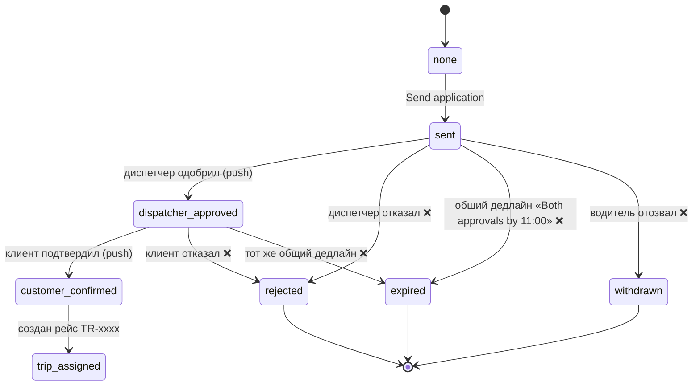
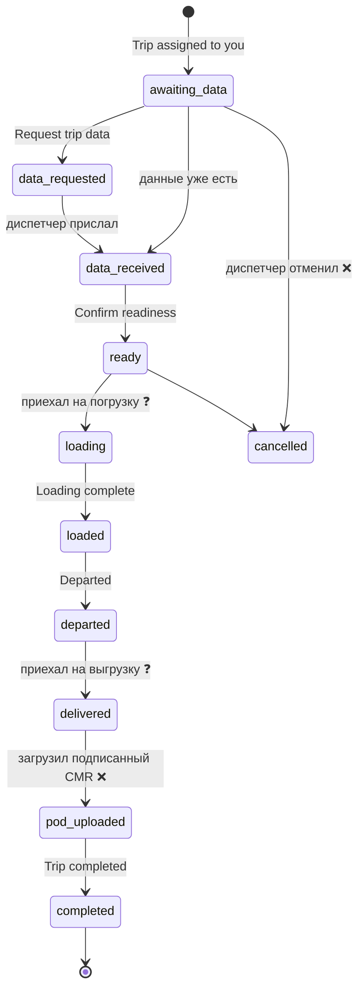

# DRIVER-FLOWS — карта флоу водителя

Рабочий документ: **проектируем флоу → согласуем → переносим в прототип по одному**.
Источники: Figma (`design/figma-map.md`), скриншоты путей (`driver-journey-complete`, `driver-gaps`,
`pending-application`, `trip-tr-4821`, `back-to-loads`), `design/PORT-LOG.md` §6–7.
Статусы: ✅ нарисовано в Figma · 🟡 нарисовано частично · ❌ нет в дизайне (предложение) · ❓ нужно решение.

## 0. Принципы «логичного» флоу

1. **Один главный следующий шаг на экране.** Всегда понятно, что делать дальше (одна primary-кнопка).
2. **Состояние объекта живёт в одном месте.** Заявка и рейс — конечные автоматы (§1); экраны только
   показывают состояние и разрешённые из него действия.
3. **Ожидание никогда не тупик.** В каждом «ждём» есть: кто ждёт, до какого времени, что будет
   по истечении, и что водитель может сделать (позвонить, написать, отозвать).
4. **У каждого входа есть выход.** Любой экран достижим минимум двумя путями (вкладка + контекст),
   и из него всегда можно вернуться.
5. **Негативные исходы — часть флоу**, а не «потом»: отказ, таймаут, отмена, нет сети, пустая выдача.
6. **Деньги и время видны до решения**, а не после (ставка, €/км, подача до погрузки, срок оплаты).

## 1. Конечные автоматы

### 1.1. Заявка на груз (Application)

Нарисовано: `sent` (Awaiting dispatcher, шаг 2 из 4), `dispatcher_approved` (Awaiting customer),
`customer_confirmed`. **Остальное — ❌.**

### 1.2. Рейс (Trip)

## 2. Флоу

### F1. Онбординг и верификация  🟡
Компоненты есть: `OnboardingProgress` (1–5), `UploadField` (4 состояния), `DrivingLicencePreview`,
`DriverProfile`. **Экранов нет.**

| Шаг | Экран | Состояния |
|---|---|---|
| 1 | Профиль водителя (имя, телефон) | empty / filled / error |
| 2 | Права (UploadField + preview) | empty / uploading / chosen / rejected |
| 3 | ТС (тип, тоннаж, паллеты, габариты) | empty / filled |
| 4 | Документы компании/допуски | empty / chosen / rejected |
| 5 | Проверка | «На проверке» / approved / отклонено с причиной |

❓ **Решение:** что доступно до верификации? Рекомендация: поиск и просмотр открыты, **«Send application»
заблокирован** с понятной причиной и ссылкой «Finish verification (3 of 5)».

### F2. Поиск грузов  🟡
Экраны: `/search` ✅ (done) → `/search/loading` → `/loads` (список) ⇄ `/map` → фильтры/сортировка (Bottom sheet).
Компоненты готовы: `RouteFields`, `LocationSuggestions` (Results/Loading/Empty/Error), `OfferCard`,
`FiltersButton`, `FilterChipV2`, `ViewSwitch`, `SortBy`.

Состояния выдачи: loading · results · **empty** ❌ · **error/offline** ❌ · filters applied (бейдж).

Нелогичности, найденные сейчас:
- ⚠️ **Destination «optional»** на `/search`, но в Bottom sheet подсказка «Choose pickup and destination —
  the button activates when both are set», и кнопка зовётся **«Show loads»**, а на экране — **«Find loads»**.
  *Предложение:* единое правило — достаточно Start; Destination необязателен; единое название «Find loads».
- ⚠️ На скриншоте 01 «Destination chosen first» кнопка disabled, пока не выбран Start — оправданно, но
  нужен текст-причина («Choose where you start»).
- ❌ Пустая выдача: предлагать «Widen radius / Remove filters / Change date».

### F3. Заявка на груз  🟡
**Решено эпиком** [`pharos-driver-flow-stories.md`](file:///Users/antonybozhatarnyk/pharos-driver-flow-stories.md)
(STORY-1…9, источник истины для этого флоу — см. §7). Короткий путь:
**Карта/список → `details-v2` → `Send application` → Loads с баннером → `Application status` (единый) → confirmed → My day / Trip.**
Подача — 2 тапа, 3 перехода вместо 5. Экрана Review нет. Verification — bottom sheet, а не экран.

| Шаг | Экран / узел Figma | Решение эпика |
|---|---|---|
| 1 | Карта `2689:15268` / список | Тап по **всей** карточке открывает details-v2 (S2) |
| 2 | `details-v2` `2767:27747` (NordCargo), `2764:12369` (BelRoute) | Порядок: Status row → Offer route → **What happens next** → Offer terms → sticky CTA (S3); CTA `Send application`, сноска «Application closes unless both approve by 11:00.» (S4); verification инлайн + sheet (S5) |
| 3 | Loads с баннером `2219:8598` (list), `2585:13234` (map), `2219:8578` (customer) | После отправки — возврат в Loads, статус баннером (S7) |
| 4 | `Application status` (бывш. `589:267` + `735:1152`) | Один экран, два состояния: awaiting-dispatcher / awaiting-customer (S6) |
| 5 | confirmed → `My day` / `Trip TR-4821` `589:334` | Каждый апрув — push (S7) |
| ✗ | `unavailable-v2` `2572:13029` | Намеренный тупик «груз недоступен» (BelRoute, S9) |

Логика апрувов (из эпика): **последовательно** — диспетчер сверяет расписание, затем клиент; **общий дедлайн**
«Both approvals by 11:00»; если к 11:00 не одобрили оба — заявка закрывается. Это **не** два независимых срока.
Отдельно живёт таймер решения водителя «Decide in 1 h 20 min» — карточка на карте показывает **оба** дедлайна,
таймер визуально главный (S8). «Applying doesn't reserve the load» — остаётся в «What happens next».

Состояния карточки (`OfferCard`): Default · Loading · Disabled · **Pending** (с Decision timer).

Дыры, **не закрытые эпиком**:
- ❌ **Отказ / истёк дедлайн 11:00 / отзыв заявки.** Эпик описывает «заявка закрывается», но не то, что видит
  водитель: баннер → причина + CTA «Find similar loads», пуш о закрытии.
- ❓ **CTA:** эпик оставляет выбор между `Send application` и `Apply for €360` — выбрать один и применить на
  NordCargo и BelRoute (вариант с суммой заодно защищает от случайного тапа вместо отдельного подтверждения).
- ❓ **Несколько заявок одновременно** (конфликт окон «Мой день»): рекомендация — можно, при `customer_confirmed`
  конфликтующие автоматически закрываются с пушем.
- ❓ **Чистка Figma-прототипа:** убрать входящие связи на архивные фреймы (`589:211`, `2689:15047`, `2004:2090`,
  второй pending) — в код они не переносятся.

### F4. Торг по ставке и чат  🟡
Компоненты: `RateOfferCard` (Proposed/Counter/Accepted), `ChatRateOffer`, `MessageBubble`,
`ChatComposer`, `ChatCargoContext`. **Экранов нет.**

Логика: водитель предлагает ставку → диспетчер: принять / контр-оффер / отказ → водитель: принять / контр /
отказ. Лимит раундов (рекомендация: 3) и срок жизни оффера. ❓ Нужно ли торговаться **до** Send application
или только после (в чате)? Рекомендация: кнопка «Offer your price» на details v2 → создаёт заявку с
предложенной ставкой (Content=Price уже есть в Bottom sheet).

Точки входа в чат: details v2, `/application/:id`, `/trip/:id`, вкладка Applications. ❌ Бейдж непрочитанных.

### F5. Рейс  🟡
`/trip/:id`: все состояния §1.2. Нарисовано: Assigned·awaiting data, Request sheet, Data requested
(demo-кнопка «dispatcher response»), Data received («Confirm readiness»), Loading complete («Departed»),
Completed («Back to My day»).

Дыры (самые важные):
- ❌ **Между «Confirm readiness» и «Loading complete» нет шагов** «Arrived at pickup» и «Loading started».
  `TripSteps` в Figma имеет 8 вариантов — **сверить**, возможно, они покрывают это.
- ❌ **«Required documents» требует «Upload signed proof after delivery»**, но на экране Completed нет
  шага загрузки — рейс завершается без подтверждения (POD/CMR). *Предложение:* состояние `delivered` →
  экран загрузки CMR (`UploadField`) → только потом `completed`.
- ❌ **Данные не пришли.** Что если диспетчер молчит? Таймер → «Call dispatcher» / «Chat».
- ❌ **Отмена рейса** диспетчером/клиентом: баннер с причиной + CTA «Find next load».
- ❌ **Задержка:** «I'm running late» (ETA) → уведомляет диспетчера.
- ❓ Навигация: «Open in Maps» по адресу pickup/delivery (кнопка рядом с адресом).

### F6. Мой день  🟡
`/my-day` — план дня: окна между рейсами («Window 11:00–13:15 · 25 min travel + 20 min buffer»,
«Check matching loads →»), назначенный рейс, «All trips». Компонент `DayItem` (Trip/Decision/Free).

Дыры:
- ❌ Пустой день · несколько рейсов · рейс завершён (куда уходит карточка).
- ❓ «Decision» (ожидание ответа по заявке) должен показываться в плане дня как
  `DayItem=Decision` с таймером — связать с F3.
- ✅ «Check matching loads →» из окна — **единственный** мост День → Поиск; он должен
  предзаполнять Start (точка окончания предыдущего рейса) и окно времени.

### F7. Оплата  ❌
Есть только `PaymentSummary` (Pending / Early available / Received). Нет ни экрана, ни входа.
*Предложение:* после `completed` — экран рейса получает блок оплаты; список «Payments» в Account.
Состояния: Pending (paid in 7 days) → Early available (CTA «Get paid now», комиссия видна) → Received.
❓ Early payment — часть MVP?

### F8. Аккаунт и настройки  ❌
Вкладка Account существует в `TabBar`, экрана нет. Минимум: профиль, ТС, документы (статус сроков),
уведомления, язык, выход, «All trips» (история). ❓ Язык интерфейса (PORT-LOG §7: сейчас English-only).

## 3. Сквозные сценарии (для проверки логики)

| # | Сценарий | Проходит через |
|---|---|---|
| S1 | Happy path: новый водитель → первый рейс закрыт | F1 → F2 → F3 → F5 → F7 |
| S2 | Заявка отклонена диспетчером → найти похожий груз | F3 (rejected) → F2 |
| S3 | Диспетчер молчит по данным рейса | F5 (data_requested, timeout) |
| S4 | Торг: контр-оффер → принят | F4 → F3 |
| S5 | Окно между рейсами → подобрать груз → подать | F6 → F2 → F3 |
| S6 | Рейс отменён за час до погрузки | F5 (cancelled) → F6 → F2 |
| S7 | Нет сети в момент «Send application» | F3 (offline) |

## 4. Сквозные состояния (применить везде)

loading (skeleton) · empty · error + retry · offline-баннер · disabled с причиной · уведомление/бейдж на вкладке.

## 5. Предлагаемый порядок добавления в прототип

1. **Каркас:** роутинг всех экранов-заглушек из `figma-map.md` + автомат Application/Trip в `store.ts`
   (+ Demo-панель управляет автоматом). *Исправляет текущий разрыв README ↔ код.*
2. **F2 Поиск** целиком (`/search/loading` → `/loads` → `/map`, empty/error).
3. **F3 Заявка** (details v2 → send → баннер → status, + rejected/expired/withdrawn).
4. **F5 Рейс** (все состояния, + POD-загрузка, cancelled).
5. **F6 Мой день** (связка с F3 и F2).
6. **F4 Торг/чат.**
7. **F1 Онбординг** (+ гейтинг заявки).
8. **F7 Оплата**, **F8 Аккаунт.**

Каждый шаг = отдельный коммит по правилам `AGENTS.md`: контракт-шапка, роут, запись в `figma-map.md`,
стори на состояния, замер и запись в `PORT-LOG.md` для всего нарисованного в Figma. Состояния «❌»
помечаются в журнале как **prototype-led** (дизайн вернётся в Figma после).

## 6. Открытые решения (нужен ответ владельца продукта)

1. Что доступно до верификации (F1)? — рекомендация: поиск да, заявка нет. (Эпик верифицирует **заказчика**
   инлайн в details-v2, но не говорит о верификации **водителя** как условии подачи.)
2. ~~Одобрения последовательные или параллельные~~ — **решено эпиком**: последовательно, общий дедлайн.
   Остаётся: что видит водитель при закрытии заявки (F3 ❌).
3. Торг до отправки заявки или только в чате; лимит раундов (F4).
4. Обязательна ли загрузка POD/CMR для завершения рейса (F5) — рекомендация: да.
5. Early payment в MVP? (F7)
6. Шаги «Arrived / Loading started» — отдельные или объединены в одну кнопку (F5; сверить `TripSteps`).
7. Автозакрытие конфликтующих заявок при подтверждении (F3/F6).
8. CTA: `Send application` или `Apply for €360` (F3, STORY-4).

## 7. Источники истины и приоритет

1. **[`pharos-driver-flow-stories.md`](file:///Users/antonybozhatarnyk/pharos-driver-flow-stories.md)** — эпик
   «увидел груз → подал заявку», 9 stories. Для F3 и стыков F2→F3→F5 **побеждает любой другой источник**.
   Глобальные критерии эпика действуют на весь прототип: нет ссылок на `ARCHIVE / review` (`589:211`) и
   `ARCHIVE / details-available` (`2689:15047`); подача = 2 тапа; все строки на экранах — английские.
2. `design/figma-map.md` и Figma — для того, что эпик не затрагивает (F1, F4–F8).
3. Этот документ — предложения для дыр (❌/❓), помечаются `prototype-led`.

Соответствие эпика этапам сборки (§5): S1–S4 → «F3 details-v2»; S5 → verification sheet; S6 → единый
`Application status`; S7 → баннер в Loads + push→My day/Trip; S8 → таймер/дедлайны на карточке карты;
S9 → линковка и чистка (в коде = роуты без ссылок на архивные экраны, BelRoute + `unavailable-v2`).

